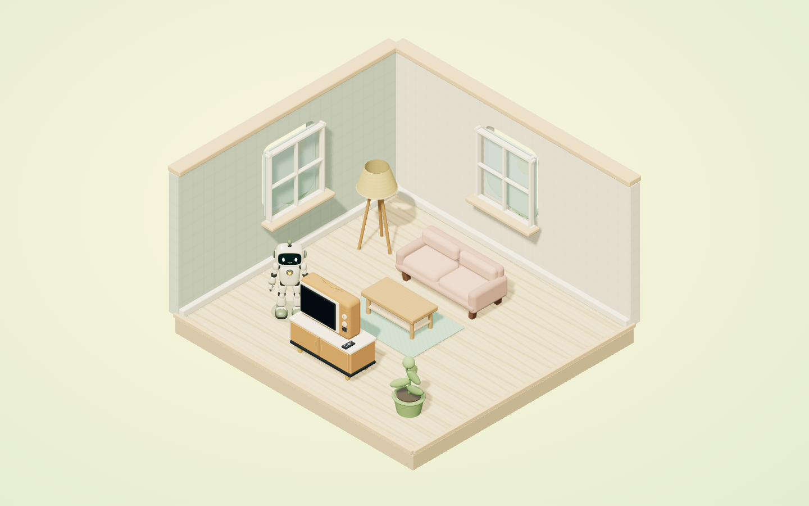
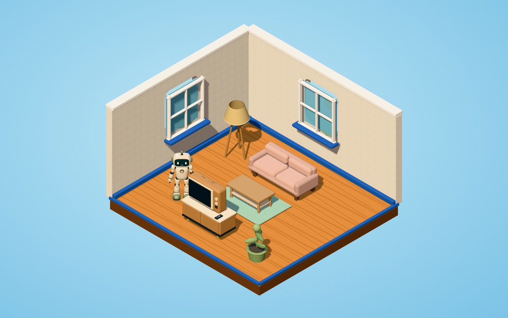
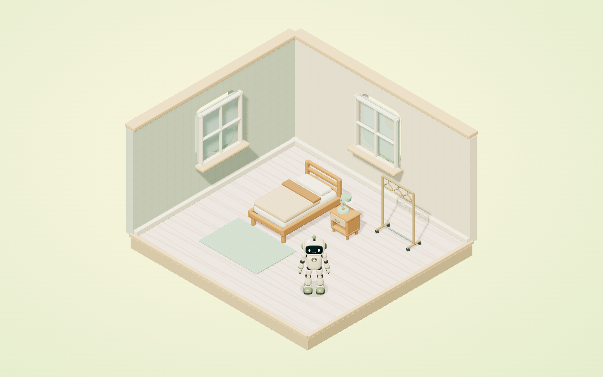
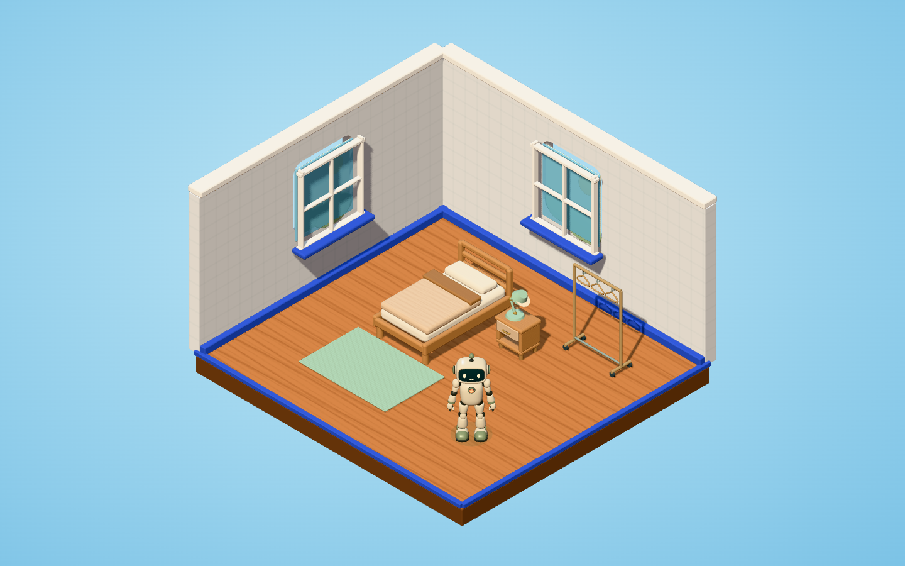
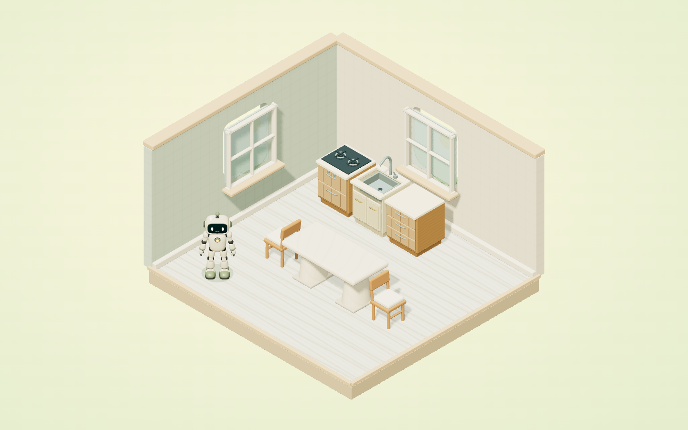
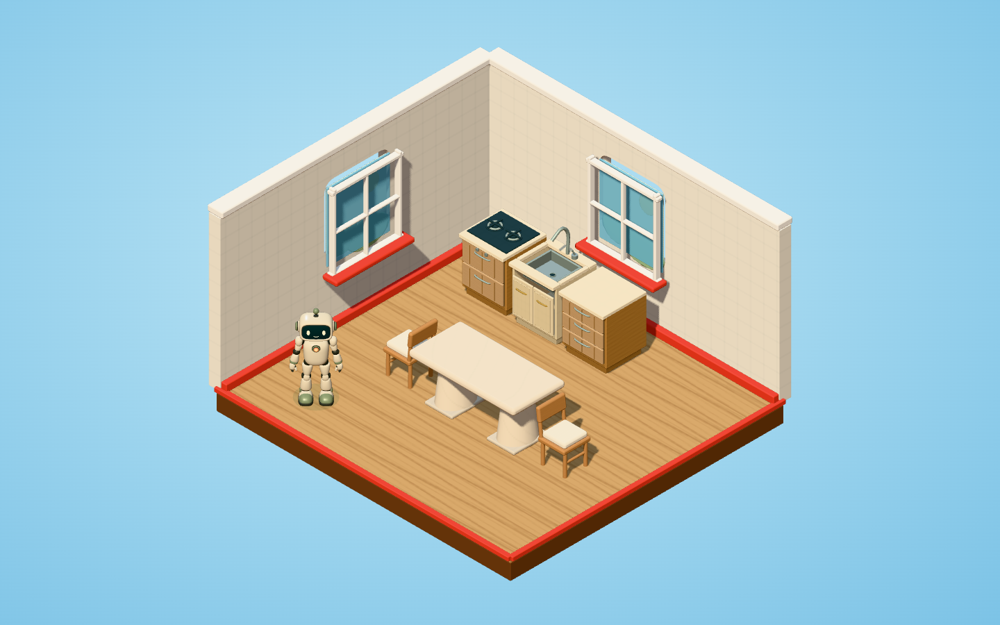
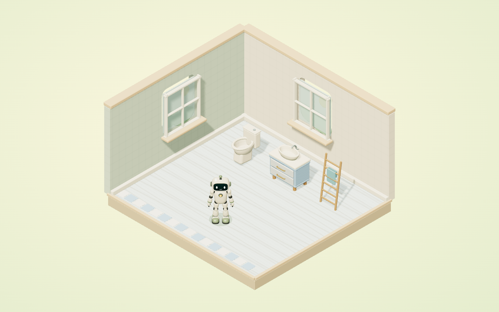
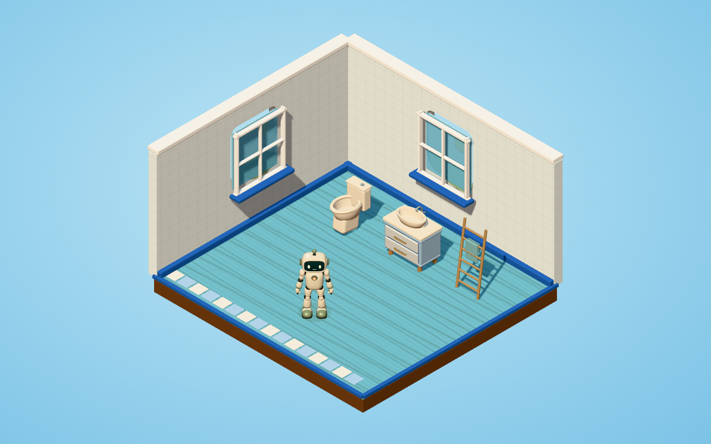
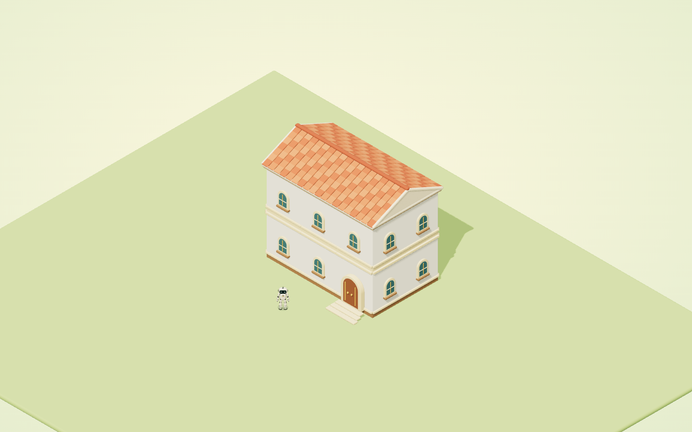
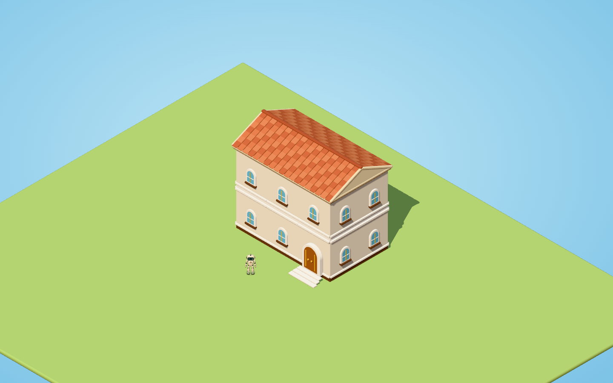

# Real-render reference captures

Captured from a fresh public GitHub clone, with no node_modules and no npm installation, using the bundled Three.js modules and the real v4 robot. Each linked PNG is the actual 1440 x 900 source render. No image-generation assets or simplified scene were used.

The five default/toy pairs have identical camera transforms and triangle counts. Furniture retains actual product default colors in every capture. Toy v1 is a frozen reference, including its current oak bathroom floor and dark plinth; it is not a new approved palette.

| Fixed view | Shipped default reference | Frozen Toy v1 reference |
| --- | --- | --- |
| Living |  |  |
| Bedroom |  |  |
| Kitchen |  |  |
| Bathroom |  |  |
| Two-storey exterior |  |  |

See verification.json and the two render-readback files for dimensions, hashes, resolved lights, actual surface maps, camera poses, mesh statistics and fictional fixture contents. This verifies browser rendering, not physical projector appearance or a production deployment.
