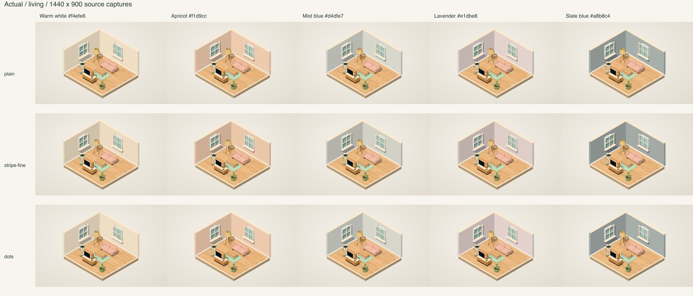
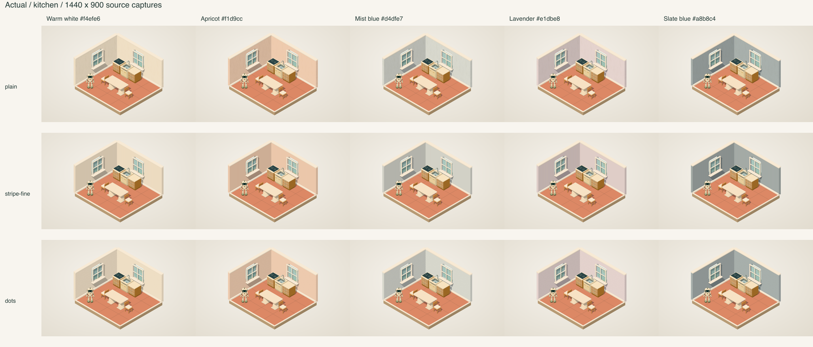

# Wall system comparison

Generated 2026-10-30T02:56:59.847Z. This is offline desktop-browser capture evidence, not a production, physical-device, or saved-account test.

## Result

PASS for the requested visual/contract scope, with the intentional differences and limits below. All 30 actual captures and 30 supplied reference captures are 1440 x 900. No geometric registration or colour normalisation was applied. RGB errors are in 8-bit channel units, 0 to 255; a low whole-image mean alone is not an acceptance criterion because the background occupies much of the frame.

- Diagnostics: 30/30 snapshots ready, fixture/dimensions correct, camera/lighting/backdrop fixed within each scene, actual wall colour/style/repeat correct, furniture colour/material equal to each SKU default.
- Across the 15 actual wall variants in each scene, all sampled furniture/robot interior crops have maximum mean RGB difference 0.0000 against actual plain/warmwhite. These crops are unchanged by wall style/colour selection.
- Against the supplied references, sampled furniture/robot crops have maximum mean RGB difference 1.2874. Small pixel differences against the older capture are present (their source was not causally isolated); this report does not call the furniture pixel-identical to the reference. Visual inspection confirms unchanged object proportions, placement, principal colours, and textures.
- Stripe top-wall scan lines have minimum zero-shift correlation 0.9996; maximum best-shift magnitude 0.0000 screen pixels. This checks alignment without shifting images. The physical repeat is independently read back as 1.2 x 2.85 m, and the seeded texture/unit tests verify a 10 cm stripe cycle with a 5 cm dark band.
- Dots intentionally differ: approved actual dots are 2.8 cm world-space circles. The archived prototype used a pixel circle on a 1.2 x 2.85 m texture, stretching its vertical world diameter to 6.65 cm. Projected screen dots are naturally foreshortened by the isometric camera; they are not expected to appear as screen-space circles.
- Narrow exposed wall ends now use real metre UVs. Their stripe/dot orientation is not required to reproduce the prototype's side-UV distortion. Original wall shape, window holes and furniture remain.

## Visual inspection

The 3 x 5 matrices retain the same scene, camera, furniture and lighting across each row/column. Plain retains a very subtle plaster variation; fine stripes have the same visible broad-face spacing and phase as the supplied source. Warm white, apricot, mist blue, lavender and slate blue retain the requested hue/lightness progression. Actual dots are visibly smaller vertically than the reference, as approved. Furniture remains recognisable and consistent in both scenes: living sofa/table/TV/lamp/rug/plant, and kitchen stove/sink/cabinets/table/chairs.

The corresponding reference matrices are [living](reference-matrix-living.png) and [kitchen](reference-matrix-kitchen.png). Enlarged same-coordinate details: [stripes living](detail-stripe-fine-living.png), [stripes kitchen](detail-stripe-fine-kitchen.png), [dots living](detail-dots-living.png), [dots kitchen](detail-dots-kitchen.png).

## Summary metrics

| Style | Pairs | Mean whole-image MAE | Mean broad wall-region MAE | Mean clean wall-patch MAE |
|---|---:|---:|---:|---:|
| plain | 10 | 0.0754 | 0.1295 | 0.0156 |
| stripe-fine | 10 | 0.1036 | 0.1479 | 0.0473 |
| dots | 10 | 0.2775 | 1.3457 | 1.6436 |

The broad wall mask includes unchanged windows and small occlusions. The clean wall patch is a fixed 45 x 25 px patch without furniture/window overlap. These are disclosed masks, not automatic segmentation. Exact ROIs, SHA-256 values, means, RMSE, thresholds, stripe scan correlations, source diagnostics and all per-item crop statistics are in [metrics.json](metrics.json); [pairs.csv](pairs.csv) is the compact table.

## All 30 direct pairs

| Pair | Whole RGB MAE | Wall RGB MAE | P95 channel error | Pixels >3 error (%) |
|---|---:|---:|---:|---:|
| plain-c1--living.png | 0.0842 | 0.1119 | 0 | 0.3220 |
| plain-c3--living.png | 0.0847 | 0.1115 | 1 | 0.3215 |
| plain-c7--living.png | 0.0881 | 0.1206 | 1 | 0.3402 |
| plain-c8--living.png | 0.0857 | 0.1147 | 1 | 0.3292 |
| plain-c9--living.png | 0.0852 | 0.1130 | 1 | 0.3368 |
| stripe-fine-c1--living.png | 0.1102 | 0.1322 | 1 | 0.8267 |
| stripe-fine-c3--living.png | 0.1093 | 0.1288 | 1 | 0.8273 |
| stripe-fine-c7--living.png | 0.1190 | 0.1377 | 1 | 0.8641 |
| stripe-fine-c8--living.png | 0.1180 | 0.1381 | 1 | 0.8613 |
| stripe-fine-c9--living.png | 0.1122 | 0.1268 | 1 | 0.8497 |
| dots-c1--living.png | 0.2799 | 1.2917 | 1 | 1.9377 |
| dots-c3--living.png | 0.2781 | 1.2814 | 1 | 1.9495 |
| dots-c7--living.png | 0.3136 | 1.4851 | 1 | 2.1183 |
| dots-c8--living.png | 0.3100 | 1.4675 | 1 | 2.0765 |
| dots-c9--living.png | 0.2768 | 1.2713 | 1 | 2.0024 |
| plain-c1--kitchen.png | 0.0639 | 0.1423 | 0 | 0.3628 |
| plain-c3--kitchen.png | 0.0644 | 0.1422 | 0 | 0.3623 |
| plain-c7--kitchen.png | 0.0677 | 0.1505 | 0 | 0.3813 |
| plain-c8--kitchen.png | 0.0653 | 0.1446 | 0 | 0.3707 |
| plain-c9--kitchen.png | 0.0648 | 0.1433 | 0 | 0.3779 |
| stripe-fine-c1--kitchen.png | 0.0899 | 0.1626 | 0 | 0.8674 |
| stripe-fine-c3--kitchen.png | 0.0890 | 0.1596 | 0 | 0.8681 |
| stripe-fine-c7--kitchen.png | 0.0986 | 0.1675 | 0 | 0.9057 |
| stripe-fine-c8--kitchen.png | 0.0975 | 0.1680 | 0 | 0.9026 |
| stripe-fine-c9--kitchen.png | 0.0918 | 0.1572 | 0 | 0.8907 |
| dots-c1--kitchen.png | 0.2534 | 1.2785 | 0 | 1.9214 |
| dots-c3--kitchen.png | 0.2513 | 1.2660 | 0 | 1.9316 |
| dots-c7--kitchen.png | 0.2833 | 1.4447 | 0 | 2.0836 |
| dots-c8--kitchen.png | 0.2799 | 1.4282 | 0 | 2.0430 |
| dots-c9--kitchen.png | 0.2482 | 1.2430 | 0 | 1.9747 |

## Limits

- The inspection covers fixed living and kitchen classroom camera captures. It does not replace interactive, multi-room, multi-floor, persistence, or mobile-device checks.
- A wall-colour/style change need not be pixel-identical to the temporary prototype. The approved true-circle correction and metre-scaled end faces intentionally prevent exact matches.
- Interior furniture crops and SKU diagnostics substantiate unchanged materials/colours; they do not prove every silhouette pixel is identical to the older reference capture.
- Pattern dimensions and roundness are supported by actual texture metadata plus deterministic geometry/UV unit tests, not inferred solely from oblique pixels.
- No real student data, save API or account was read or modified by this script.

Reproduce from repository root: `node scripts/qa/look-dev-wall-compare.mjs`. Optional flags: `--actual DIR --reference DIR --output DIR --readbacks FILE`.
