# Warm floor candidate: real-render evidence

**Appearance source pending:** these captures validate floor implementation under inherited default lighting. The requested warm-v6 preset and reviewer comparison images were not supplied. They do not establish a warm-v6 visual match. No production deployment was performed.

## Fixed Look Dev views

Actual 1440 x 900 PNGs from the real rendering modules, with default furniture colors. Cameras match the original default reference views exactly.

| Living | Bedroom |
| --- | --- |
| 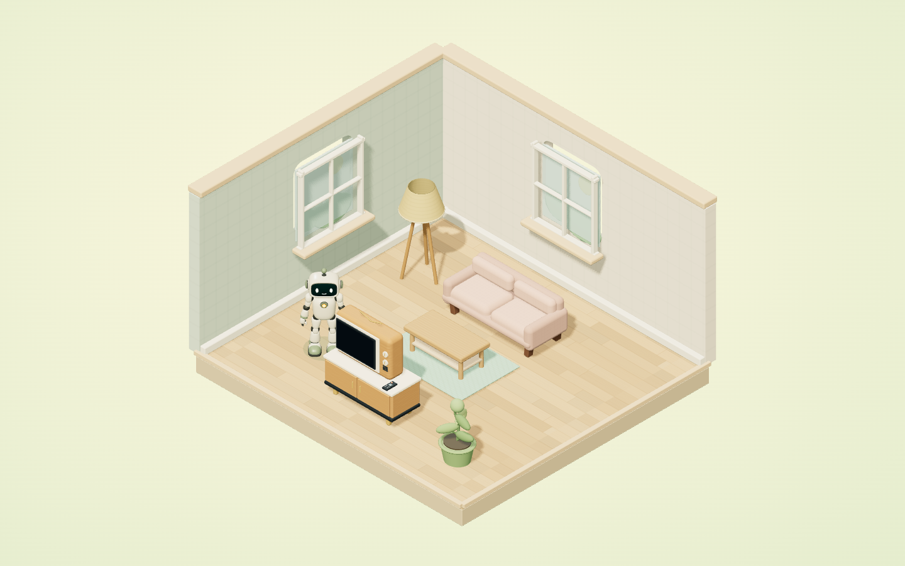 | 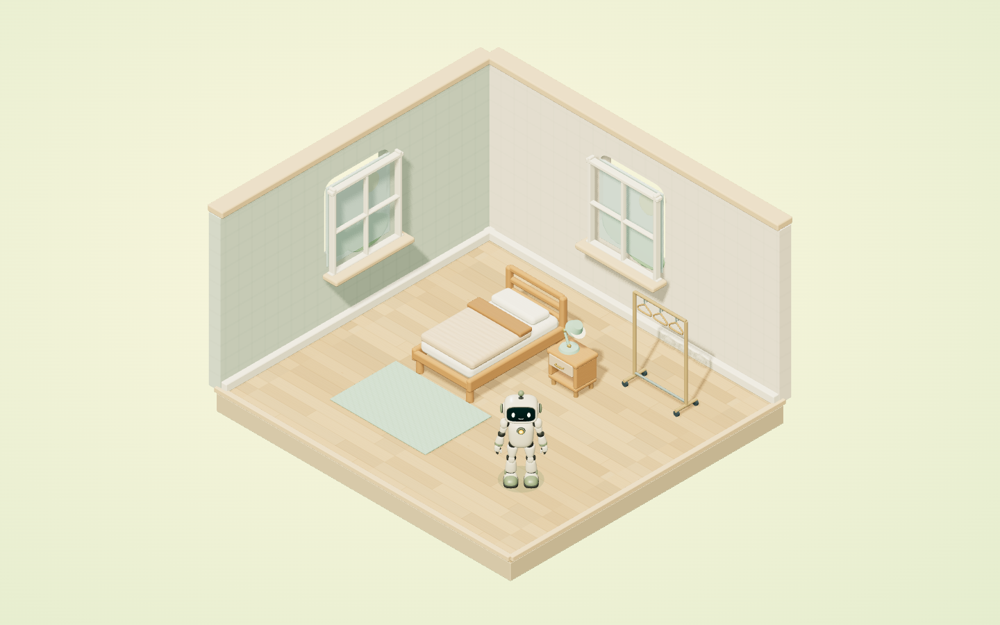 |

| Kitchen | Bathroom |
| --- | --- |
| 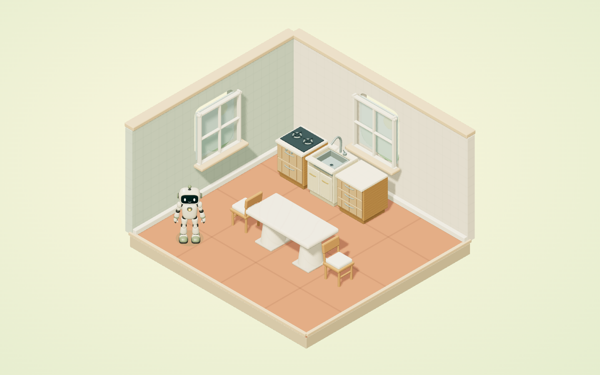 | 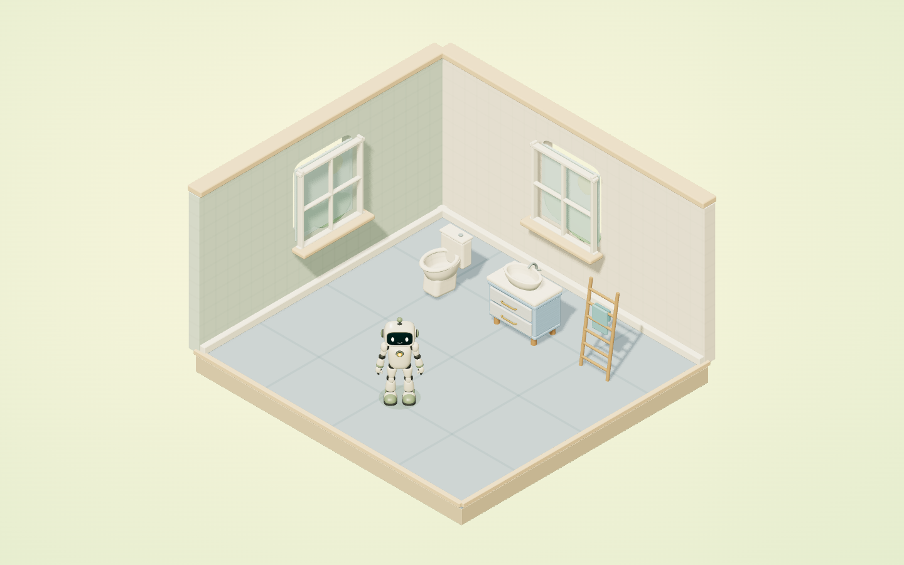 |

[Two-storey exterior capture](warm-floors--exterior.png)

## Actual authenticated application, one fictional student

All fourteen choices were clicked through the real application context menu, saved by the actual server command and captured. These are direct room crops of application screenshots, with account/product UI removed for source-review privacy. They are not Look Dev reconstructions. Full original local screenshots were retained privately.

Six wood choices in the same bedroom:

| Finish | Actual application |
| --- | --- |
| wood-light-oak | 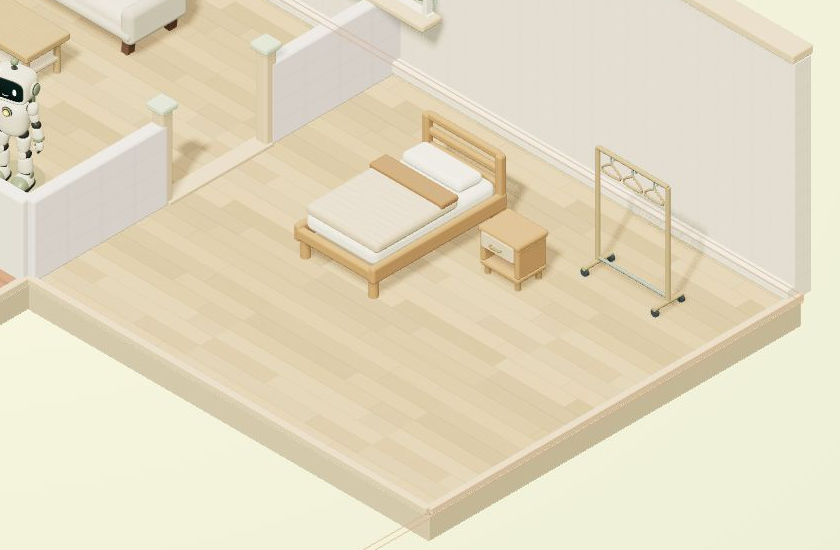 |
| wood-walnut |  |
| wood-washed-oak | 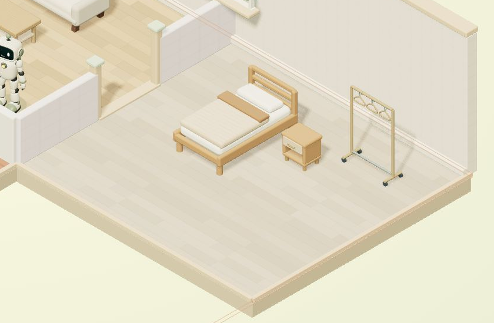 |
| wood-herringbone-oak | 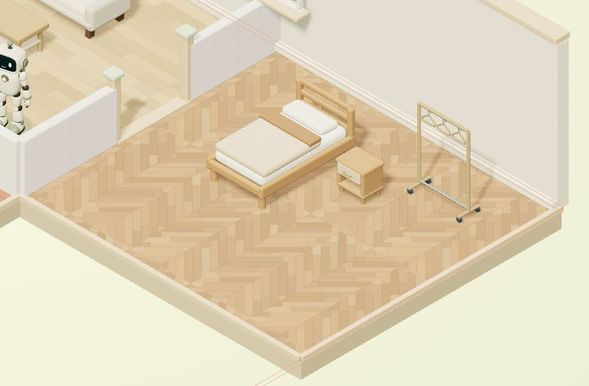 |
| wood-cherry | 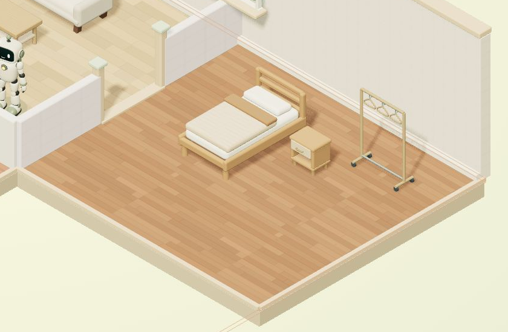 |
| wood-herringbone-walnut | 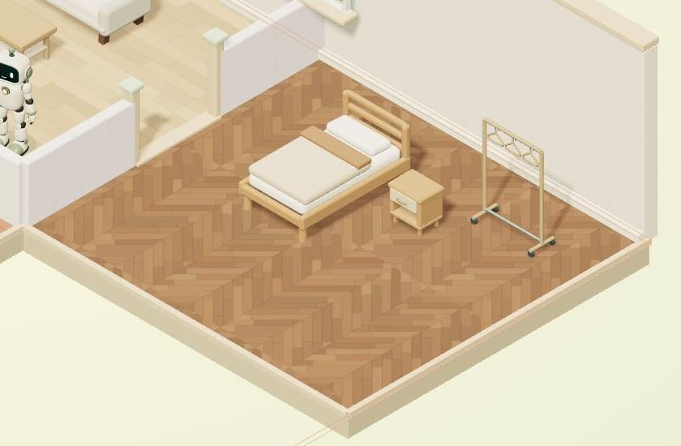 |

Eight tile choices in the same kitchen:

| Finish | Actual application |
| --- | --- |
| tile-terracotta-deep | 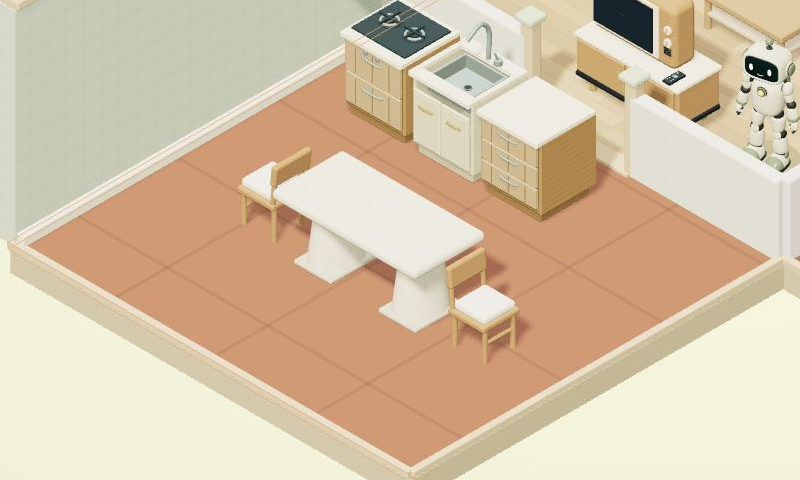 |
| tile-terracotta | 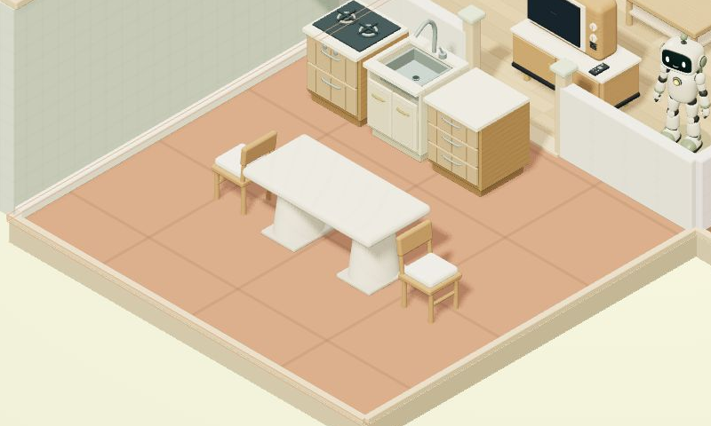 |
| tile-terracotta-light | 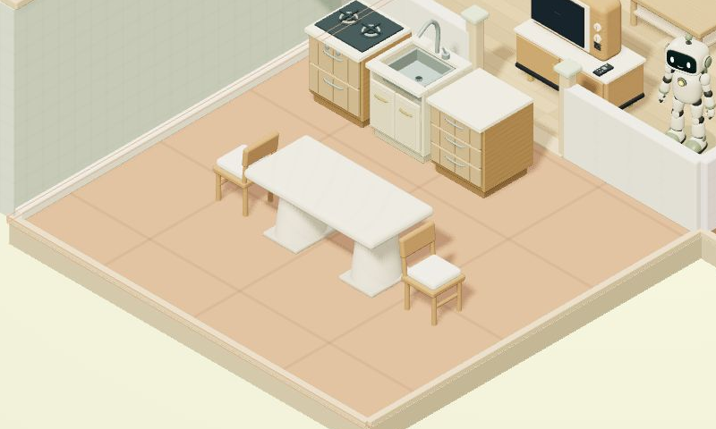 |
| tile-caramel | 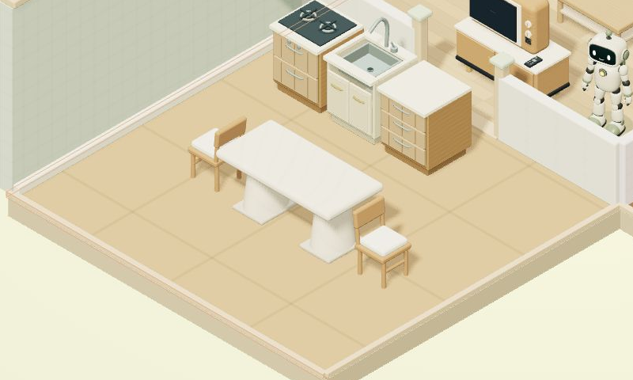 |
| tile-sand | 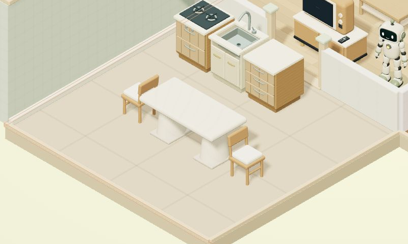 |
| tile-stone | 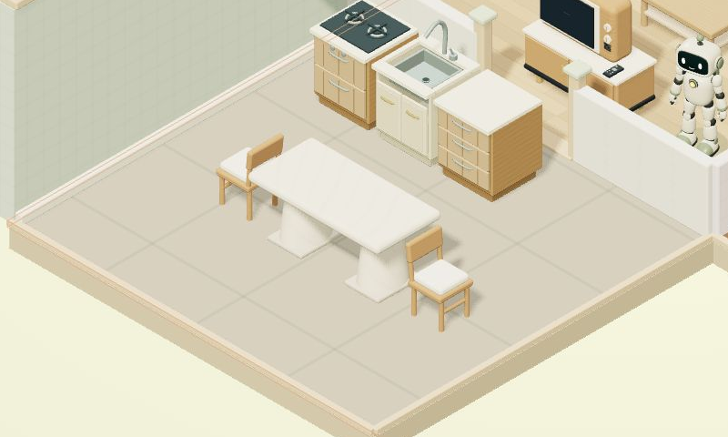 |
| tile-blue | 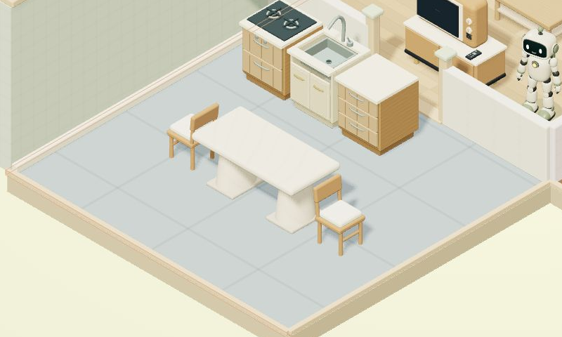 |
| tile-charcoal | 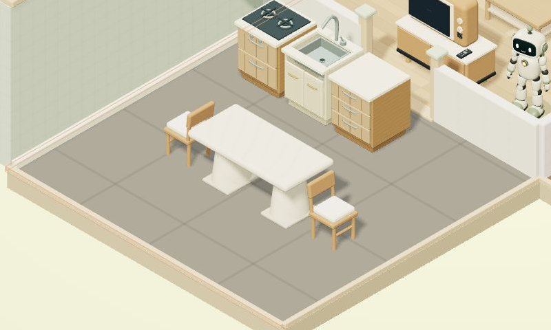 |

All fourteen delivered finish receipts had amount zero. The first student's wallet stayed unchanged, refresh restored the selected finish, and switching to a second fictional student and back preserved isolation. Old color/material fields remain intact. See [application readback](application-verification.json).

All ten default/toy source PNGs remain byte-identical to the preceding gallery. See [hash comparison](default-toy-final-comparison.json) and [actual warm material/repeat/camera readbacks](warm-render-readback.json). Texture scale/caching and legacy fallback also have focused automated coverage. The missing warm-v6/reference-image comparison remains open; physical classroom/projector appearance was not tested.
